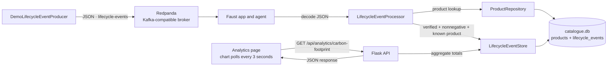
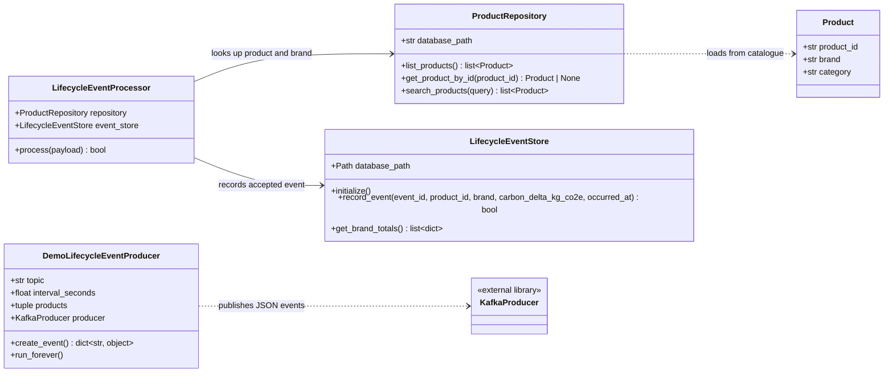

# cepApp
Capstone Project for the Compact Programming Course in Python. This is an AI-powered web app for exploring electronics product passports, evaluating circularity, and understanding sustainability through data, analytics, and AI.
<<<<<<< HEAD

Prof. Dr. Galyna Tabunshchyk

Group 11.
Topic: AI-Powered Circular Economy Product Passport

| Student                    | Matriculation number | Subsystem                                                        |
| -------------------------- | -------------------- | ---------------------------------------------------------------- |
| Rodrigo Castillo Alcantara | ESE - 7226791        | - Analytics Subsystem<br>- AI provider Subsystem               |
| Elnur Allazov              | ESE - 7226316        | - Product Data Subsystem<br>- Circularity Assessment Subsystem |

# [Homeworkassignment001] Subsystem UML Class Diagrams

The following diagrams describe the classes present in each of the application subsystems.

For more information watch the presentation video: [HomeAssignment1-CPC(GROUP 11)](https://www.youtube.com/watch?v=vU1BhcSXFp0)

## 1. Product Data Subsystem



## 2. Circularity Assessment Subsystem



## 3. Analytics Subsystem



## 4. AI provider Subsystem



## 5. Tool - QR generator utility




---
=======
>>>>>>> Homeworkassignment002

Prof. Dr. Galyna Tabunshchyk

Group 11.
Topic: AI-Powered Circular Economy Product Passport

| Student                    | Matriculation number | Subsystem                                                        |
| -------------------------- | -------------------- | ---------------------------------------------------------------- |
| Rodrigo Castillo Alcantara | ESE - 7226791        | - Analytics Subsystem<br>- AI provider Subsystem               |
| Elnur Allazov              | ESE - 7226316        | - Product Data Subsystem<br>- Circularity Assessment Subsystem |

# [Homeworkassignment002] Architecture Diagrams

For more information watch the presentation video: [HomeAssignment2-CPC(GROUP 11)](https://www.youtube.com/watch?v=BfJSN0wDNUU)

## Real-Time Processing Pipeline



Compose runs Redpanda, the Faust worker, the demo producer, and Flask. The
faust worker and web app share the `catalogue.db` SQLite file.

## Live analytics feature: class diagrams



---

### Run the Docker Compose demo

1. Start Docker Desktop.
2. From the project folder, start all services:
   ```powershell
   docker compose up --build
   ```
3. Open the app at `http://localhost:5000`. The live brand chart is at
   `http://localhost:5000/analytics`.
4. To stop the services, press **Ctrl+C** in the terminal, then run:
   ```powershell
   docker compose down
   ```
