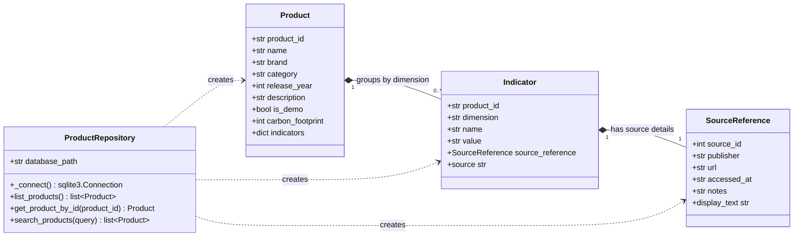
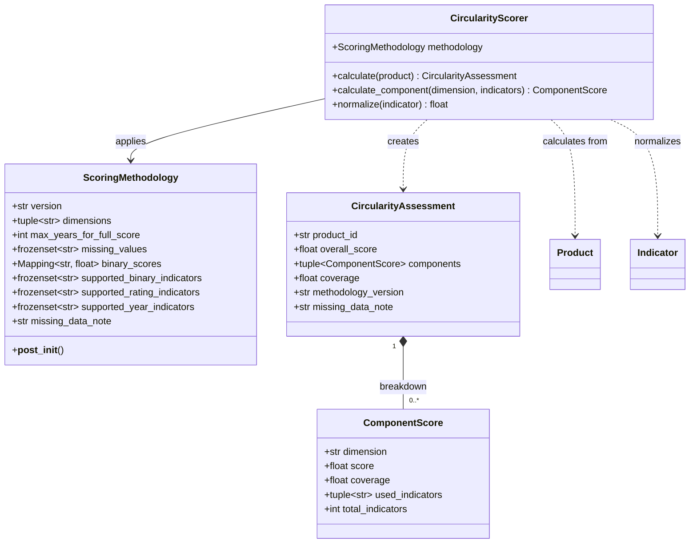
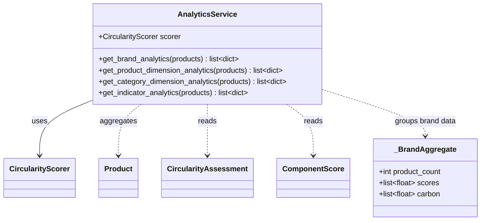
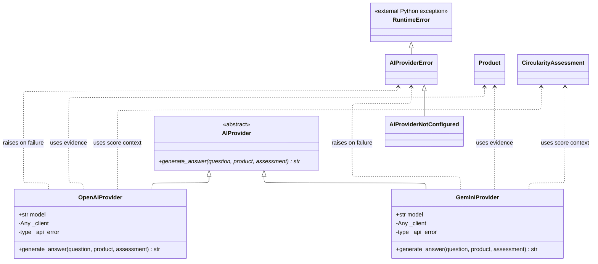
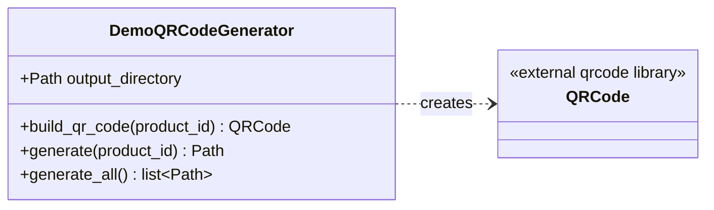

# Subsystem UML Class Diagrams

These diagrams describe the classes present in each of the application subsystems. The diagrams in this document are the source text of the mermaid diagrams rendered in the README:md file.

## 1. Product Data Subsystem

## 2. Circularity Assessment Subsystem

## 3. Analytics Subsystem

## 4. AI provider Subsystem

## 5. Tool - QR generator utility

`DemoQRCodeGenerator` produces SVG files with the product ID as the QR
payload.
